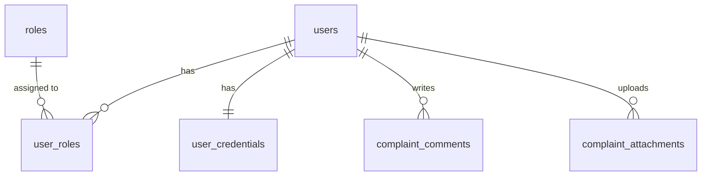
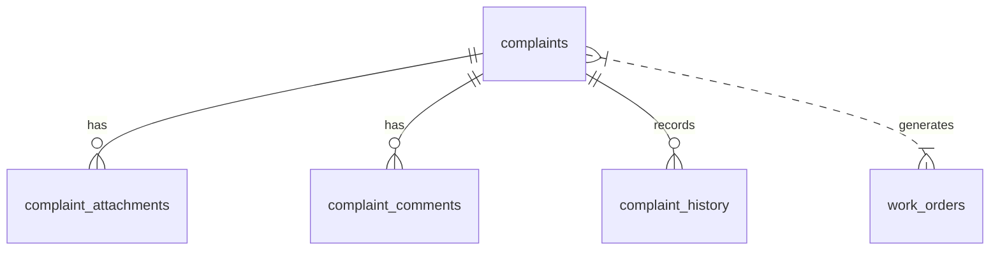
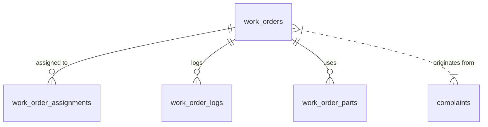

# FixFlow Database Design Documentation

**Overview**

FixFlow is a Smart Maintenance and Complaint Management Platform built as a collection of five independent micro‑services.  Each service owns its own MySQL database to enforce strong data‑ownership boundaries, enable independent scaling, and simplify schema evolution.  The services communicate exclusively through **REST/gRPC APIs** and **Kafka events**; no service accesses another service’s tables directly.

---

## 1. Identity Service

### Purpose
Manages user accounts, authentication data, roles and permissions.

### Tables
| Table | Description |
|-------|-------------|
| `users` | Core user profile.
| `user_credentials` | Password hash, MFA secrets.
| `user_roles` | Association of users to role definitions.
| `roles` | Role definitions and their default permissions.
| `oauth_providers` | External identity providers (Google, Azure AD, …).

#### `users`
```sql
CREATE TABLE users (
    user_id BIGINT UNSIGNED AUTO_INCREMENT PRIMARY KEY,
    username VARCHAR(50) NOT NULL UNIQUE,
    email VARCHAR(255) NOT NULL UNIQUE,
    first_name VARCHAR(100),
    last_name VARCHAR(100),
    status ENUM('ACTIVE','SUSPENDED','DELETED') NOT NULL DEFAULT 'ACTIVE',
    created_at TIMESTAMP DEFAULT CURRENT_TIMESTAMP,
    updated_at TIMESTAMP DEFAULT CURRENT_TIMESTAMP ON UPDATE CURRENT_TIMESTAMP
) ENGINE=InnoDB;
```
*Indexes*: unique on `username`, `email`.

#### `user_credentials`
```sql
CREATE TABLE user_credentials (
    user_id BIGINT UNSIGNED PRIMARY KEY,
    password_hash CHAR(60) NOT NULL,
    mfa_secret VARCHAR(255),
    password_last_changed TIMESTAMP,
    CONSTRAINT fk_user_credentials_user FOREIGN KEY (user_id) REFERENCES users(user_id) ON DELETE CASCADE
) ENGINE=InnoDB;
```
*Note*: one‑to‑one with `users`.

#### `roles` & `user_roles`
```sql
CREATE TABLE roles (
    role_id SMALLINT UNSIGNED AUTO_INCREMENT PRIMARY KEY,
    role_name VARCHAR(50) NOT NULL UNIQUE,
    description VARCHAR(255)
) ENGINE=InnoDB;

CREATE TABLE user_roles (
    user_id BIGINT UNSIGNED NOT NULL,
    role_id SMALLINT UNSIGNED NOT NULL,
    assigned_at TIMESTAMP DEFAULT CURRENT_TIMESTAMP,
    PRIMARY KEY (user_id, role_id),
    CONSTRAINT fk_user_roles_user FOREIGN KEY (user_id) REFERENCES users(user_id) ON DELETE CASCADE,
    CONSTRAINT fk_user_roles_role FOREIGN KEY (role_id) REFERENCES roles(role_id) ON DELETE RESTRICT
) ENGINE=InnoDB;
```
---

## 2. Complaint Service

### Purpose
Collects, tracks, and resolves citizen or tenant complaints.

### Tables
| Table | Description |
|-------|-------------|
| `complaints` | Main complaint record.
| `complaint_attachments` | Files/images linked to a complaint.
| `complaint_comments` | Free‑form comments from users, agents.
| `complaint_history` | Immutable audit trail of state changes.

#### `complaints`
```sql
CREATE TABLE complaints (
    complaint_id BIGINT UNSIGNED AUTO_INCREMENT PRIMARY KEY,
    reporter_user_id BIGINT UNSIGNED NOT NULL,
    title VARCHAR(255) NOT NULL,
    description TEXT NOT NULL,
    priority ENUM('LOW','MEDIUM','HIGH','CRITICAL') NOT NULL DEFAULT 'MEDIUM',
    status ENUM('OPEN','IN_PROGRESS','RESOLVED','CLOSED','REJECTED') NOT NULL DEFAULT 'OPEN',
    created_at TIMESTAMP DEFAULT CURRENT_TIMESTAMP,
    updated_at TIMESTAMP DEFAULT CURRENT_TIMESTAMP ON UPDATE CURRENT_TIMESTAMP,
    CONSTRAINT fk_complaints_reporter FOREIGN KEY (reporter_user_id) REFERENCES users(user_id) ON DELETE RESTRICT
) ENGINE=InnoDB;
```
*Indexes*: `status`, `priority`, `reporter_user_id`.

#### `complaint_attachments`
```sql
CREATE TABLE complaint_attachments (
    attachment_id BIGINT UNSIGNED AUTO_INCREMENT PRIMARY KEY,
    complaint_id BIGINT UNSIGNED NOT NULL,
    file_path VARCHAR(512) NOT NULL,
    mime_type VARCHAR(100),
    uploaded_at TIMESTAMP DEFAULT CURRENT_TIMESTAMP,
    CONSTRAINT fk_att_complaint FOREIGN KEY (complaint_id) REFERENCES complaints(complaint_id) ON DELETE CASCADE
) ENGINE=InnoDB;
```

#### `complaint_comments`
```sql
CREATE TABLE complaint_comments (
    comment_id BIGINT UNSIGNED AUTO_INCREMENT PRIMARY KEY,
    complaint_id BIGINT UNSIGNED NOT NULL,
    author_user_id BIGINT UNSIGNED NOT NULL,
    comment TEXT NOT NULL,
    created_at TIMESTAMP DEFAULT CURRENT_TIMESTAMP,
    CONSTRAINT fk_comment_complaint FOREIGN KEY (complaint_id) REFERENCES complaints(complaint_id) ON DELETE CASCADE,
    CONSTRAINT fk_comment_user FOREIGN KEY (author_user_id) REFERENCES users(user_id) ON DELETE RESTRICT
) ENGINE=InnoDB;
```
---

## 3. Work Order Service

### Purpose
Creates work orders derived from complaints, tracks execution by field technicians, and records completion data.

### Tables
| Table | Description |
|-------|-------------|
| `work_orders` | Core work‑order entity.
| `work_order_assignments` | Technician assignments.
| `work_order_logs` | Time‑stamped activity logs.
| `work_order_parts` | Parts/materials used.

#### `work_orders`
```sql
CREATE TABLE work_orders (
    wo_id BIGINT UNSIGNED AUTO_INCREMENT PRIMARY KEY,
    source_complaint_id BIGINT UNSIGNED NOT NULL,
    title VARCHAR(255) NOT NULL,
    description TEXT,
    status ENUM('OPEN','ASSIGNED','IN_PROGRESS','COMPLETED','CANCELLED') NOT NULL DEFAULT 'OPEN',
    priority ENUM('LOW','MEDIUM','HIGH','CRITICAL') NOT NULL DEFAULT 'MEDIUM',
    scheduled_start DATETIME,
    scheduled_end DATETIME,
    created_at TIMESTAMP DEFAULT CURRENT_TIMESTAMP,
    updated_at TIMESTAMP DEFAULT CURRENT_TIMESTAMP ON UPDATE CURRENT_TIMESTAMP,
    CONSTRAINT fk_wo_complaint FOREIGN KEY (source_complaint_id) REFERENCES complaints(complaint_id) ON DELETE RESTRICT
) ENGINE=InnoDB;
```
*Indexes*: `status`, `priority`, `source_complaint_id`.

#### `work_order_assignments`
```sql
CREATE TABLE work_order_assignments (
    wo_id BIGINT UNSIGNED NOT NULL,
    technician_user_id BIGINT UNSIGNED NOT NULL,
    assigned_at TIMESTAMP DEFAULT CURRENT_TIMESTAMP,
    PRIMARY KEY (wo_id, technician_user_id),
    CONSTRAINT fk_assign_wo FOREIGN KEY (wo_id) REFERENCES work_orders(wo_id) ON DELETE CASCADE,
    CONSTRAINT fk_assign_user FOREIGN KEY (technician_user_id) REFERENCES users(user_id) ON DELETE RESTRICT
) ENGINE=InnoDB;
```
---

## 4. Notification Service

### Purpose
Delivers email, SMS, push‑notifications, or in‑app alerts based on events generated by other services.

### Tables
| Table | Description |
|-------|-------------|
| `notifications` | Outbound notification records.
| `notification_templates` | Re‑usable message templates.
| `notification_subscriptions` | User subscription preferences.

#### `notifications`
```sql
CREATE TABLE notifications (
    notification_id BIGINT UNSIGNED AUTO_INCREMENT PRIMARY KEY,
    recipient_user_id BIGINT UNSIGNED NOT NULL,
    channel ENUM('EMAIL','SMS','PUSH','IN_APP') NOT NULL,
    template_id INT UNSIGNED,
    payload JSON,
    status ENUM('PENDING','SENT','FAILED') NOT NULL DEFAULT 'PENDING',
    created_at TIMESTAMP DEFAULT CURRENT_TIMESTAMP,
    sent_at TIMESTAMP NULL,
    CONSTRAINT fk_notif_user FOREIGN KEY (recipient_user_id) REFERENCES users(user_id) ON DELETE CASCADE,
    CONSTRAINT fk_notif_template FOREIGN KEY (template_id) REFERENCES notification_templates(template_id) ON DELETE SET NULL
) ENGINE=InnoDB;
```
*Indexes*: `status`, `recipient_user_id`.

#### `notification_subscriptions`
```sql
CREATE TABLE notification_subscriptions (
    user_id BIGINT UNSIGNED PRIMARY KEY,
    email_opt_in BOOLEAN NOT NULL DEFAULT TRUE,
    sms_opt_in BOOLEAN NOT NULL DEFAULT FALSE,
    push_opt_in BOOLEAN NOT NULL DEFAULT TRUE,
    updated_at TIMESTAMP DEFAULT CURRENT_TIMESTAMP ON UPDATE CURRENT_TIMESTAMP,
    CONSTRAINT fk_sub_user FOREIGN KEY (user_id) REFERENCES users(user_id) ON DELETE CASCADE
) ENGINE=InnoDB;
```
---

## 5. Reporting Service

### Purpose
Provides aggregated, read‑only views for dashboards and export (CSV/Excel).  It **does not** own write‑able data; it consumes Kafka topics and populates materialized view tables.

### Tables (read‑only, populated by CDC / Kafka)
| Table | Description |
|-------|-------------|
| `report_complaint_summary` | One‑row per complaint with current status, age, and assigned work‑order.
| `report_work_order_metrics` | Aggregated metrics per technician, priority, SLA compliance.
| `report_user_activity` | Counts of login, complaint creation, work‑order actions.

#### `report_complaint_summary`
```sql
CREATE TABLE report_complaint_summary (
    complaint_id BIGINT UNSIGNED PRIMARY KEY,
    title VARCHAR(255),
    status VARCHAR(20),
    priority VARCHAR(20),
    created_at TIMESTAMP,
    updated_at TIMESTAMP,
    assigned_wo_id BIGINT UNSIGNED,
    assigned_technician_id BIGINT UNSIGNED,
    INDEX idx_status (status),
    INDEX idx_priority (priority)
) ENGINE=InnoDB;
```
*Note*: Populated by a Kafka consumer that merges `complaints`, `work_orders`, and `work_order_assignments`.

---

## Inter‑Service Communication

1. **REST/gRPC APIs** – Each service exposes an HTTP/gRPC endpoint for the operations it owns (e.g., `GET /users/{id}` in Identity, `POST /complaints` in Complaint).  Clients (frontend or other services) call these APIs; they never issue SQL against another service’s DB.
2. **Event‑Driven Synchronisation via Kafka** – When a microservice changes its state it publishes a domain event to a Kafka topic:
   * `identity.user-created`, `identity.user-updated`
   * `complaint.created`, `complaint.status-changed`
   * `workorder.created`, `workorder.status-updated`
   * `notification.sent`
   * `reporting.refresh-request`
3. **Consumers** – Other services subscribe to the topics they need.  For example, the **Work Order Service** consumes `complaint.created` to automatically generate a work order, while the **Reporting Service** consumes `complaint.*` and `workorder.*` to keep its materialized tables in sync.
4. **Event schema** – Use Avro/Protobuf with a shared schema registry.  Each event contains a UUID, timestamp, and the minimal payload required (e.g., `complaintId`, `status`).
5. **Idempotency & Ordering** – Kafka partitions are keyed by the aggregate root ID (e.g., `complaintId`).  This guarantees ordering per entity and enables idempotent processing via the event’s UUID.

---

## Mermaid ER Diagrams

### Identity Service


### Complaint Service


### Work Order Service


---

## Production‑Readiness Tips for Spring Boot

* **Flyway** or **Liquibase** migrations – keep each service’s `db/migration` folder under version control.
* **Connection pooling** – use HikariCP with appropriate max‑pool size per service.
* **Read‑replicas** – for reporting or heavy read patterns, configure a read‑only replica and point the Reporting Service at it.
* **Circuit breakers** – wrap remote API calls (e.g., Identity lookup) with Resilience4j to avoid cascading failures.
* **Transaction boundaries** – each service owns a single DB transaction; cross‑service consistency is achieved via eventual consistency (Kafka events).
* **Testing** – unit‑test each repository layer; integration tests spin up a MySQL Docker container per service.

---

*Document generated on 2026‑11‑15.*